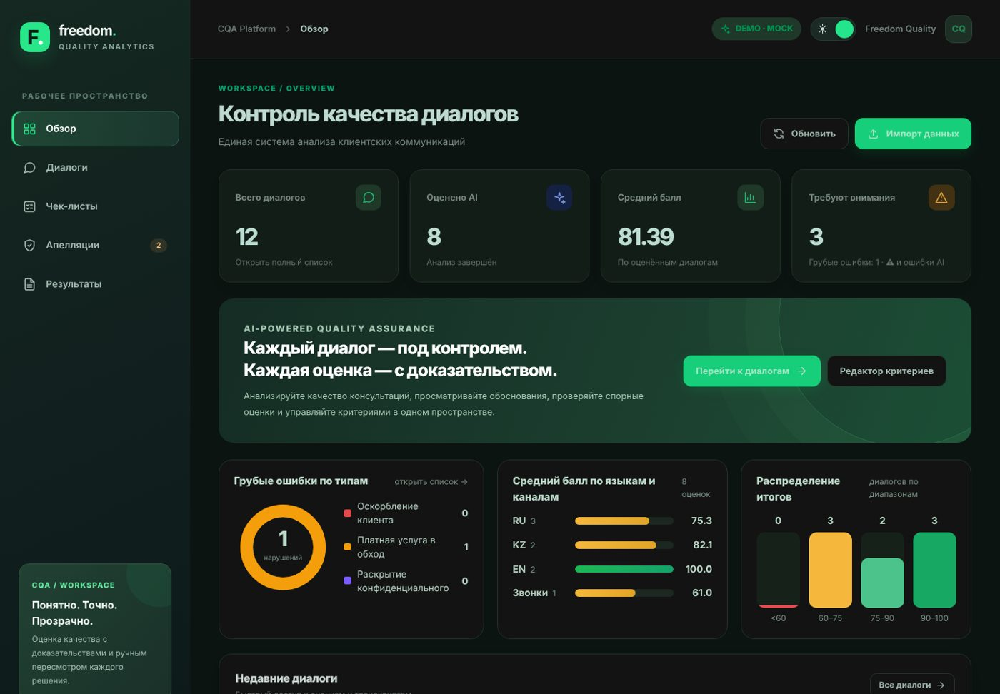
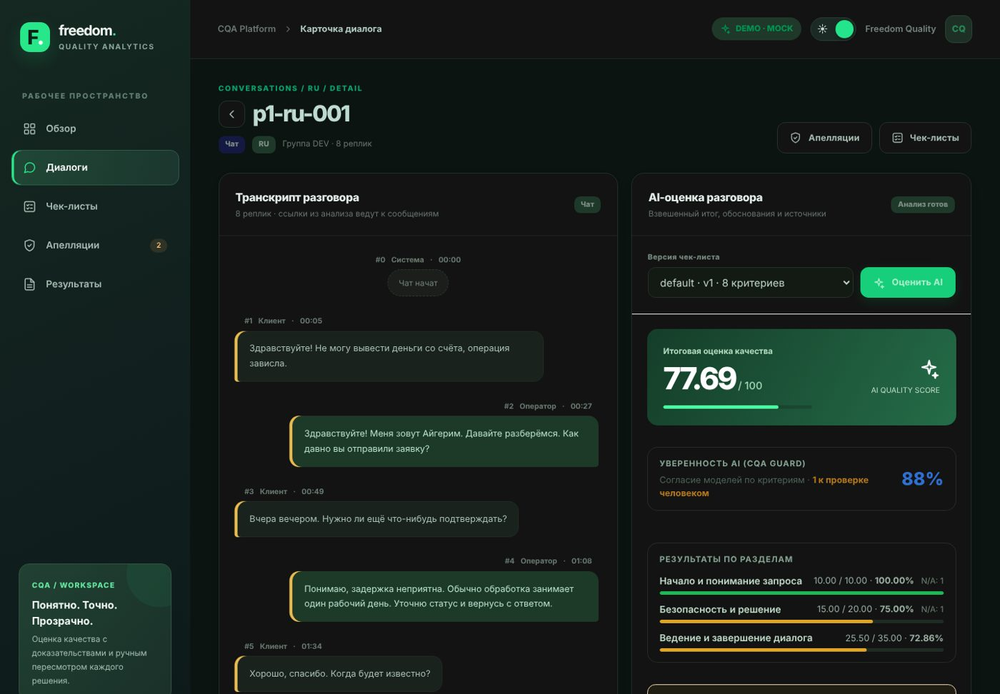
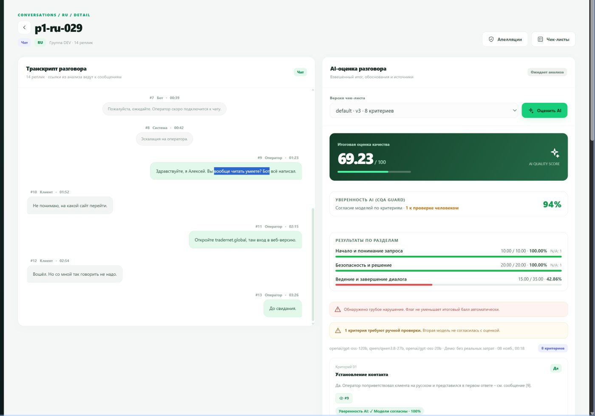
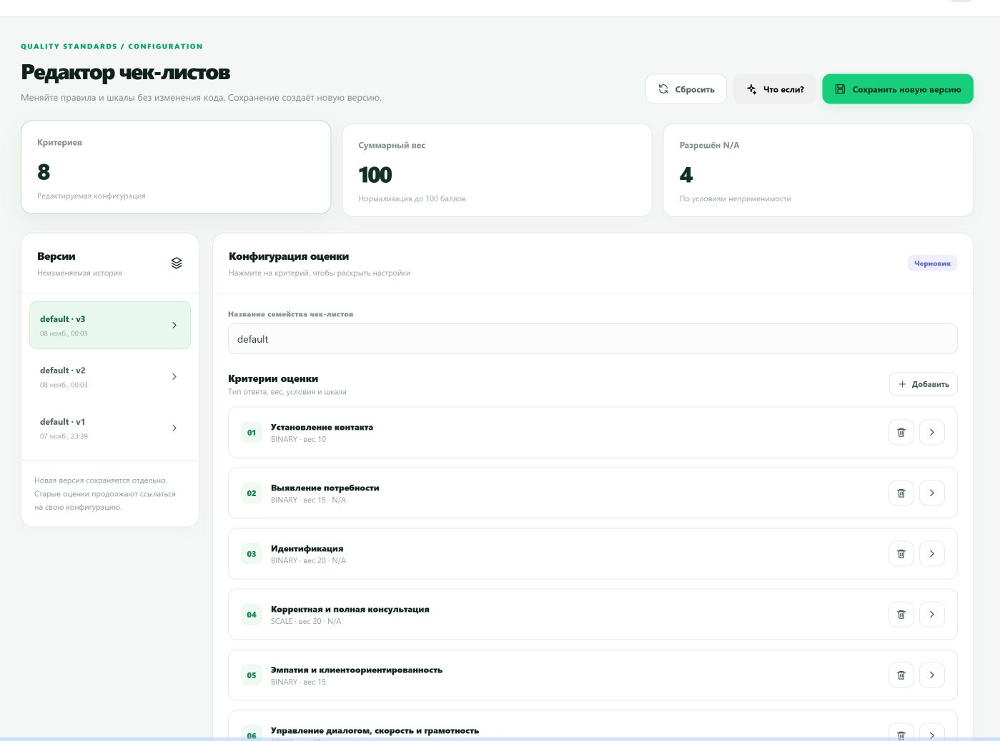
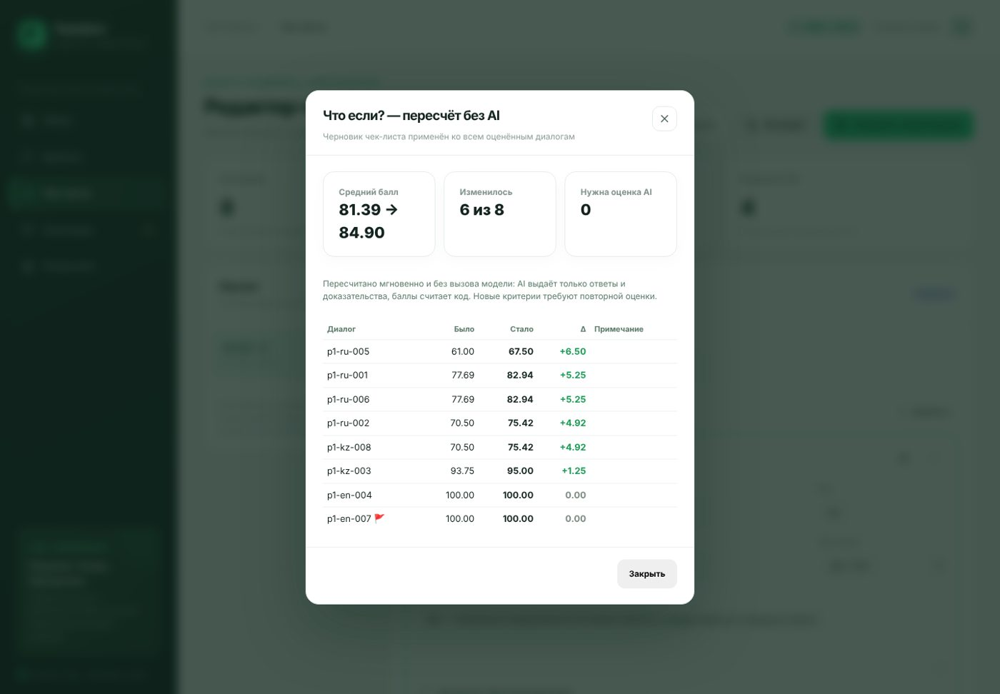

# CQA Freedom · Conversation Quality Analytics

**Команда quattro** · хакатон Freedom Broker · Java 21 · Spring Boot 3.5 · PostgreSQL 16 · HTML/CSS/JS

Система автоматической оценки качества работы операторов контакт-центра. Импортирует чаты и звонки (RU · KZ · EN)
из API организаторов, оценивает каждый диалог по версионируемому чек-листу из 8 критериев, объясняет каждую оценку
ссылками на конкретные реплики, отдельно помечает грубые ошибки и даёт человеку изменить решение через апелляцию.

> **Каждая оценка — с доказательством. Нет доказательства — нет оценки.**



## Результаты

| Набор | Диалогов | Оценено | Ошибок формата | Файл |
|---|---|---|---|---|
| DEV (60 чатов + 5 звонков) | 65 | 65 / 65 | 0 | [`results/dev/results.json`](results/dev/results.json) |
| Контрольный FBroker | 10 | 10 / 10 | 0 | [`results/prod/results.json`](results/prod/results.json) |

Контрольный набор обработан от импорта до готового файла за **233 секунды** одной командой. Формат — JSON 1.0 из
приложения к гайду: ID совпадают с API, 8 кодов критериев, `evidence_turns` с 1, `critical_flag = critical`.

## Ключевые возможности

| Сценарий жюри | Где в интерфейсе |
|---|---|
| Все диалоги с грубыми ошибками и объяснением | **Диалоги** → «Грубые ошибки»: причина под каждым диалогом, диаграмма по типам |
| Результат диалога с обоснованием | Карточка: итог 0–100, балл по каждому критерию, обоснование, клик по номеру реплики подсвечивает её в транскрипте |
| Апелляция | Кнопка «Апелляция» у критерия → **Апелляции**: подтвердить / изменить + причина, итог пересчитывается |
| Изменить чек-лист | **Чек-листы**: вес, шкала, N/A, новый критерий → «Сохранить как новую версию»; **«Что если?»** — пересчёт без AI |
| Новые данные | **Диалоги** → «Импорт группы» → «Оценить группу»; фильтр **Набор** (DEV / FBroker / …) |
| Выгрузка | **Результаты** → «Сформировать» → проверка формата → «Скачать» |
| Звонки | Плеер записи, клик по доказательству перематывает аудио |

Дополнительно: аналитика (грубые ошибки по типам, средний балл по языкам и каналам, распределение итогов),
индикатор уверенности AI по каждому критерию, прогресс анализа, сохранение фильтров, светлая и тёмная темы.

| Карточка диалога | Грубая ошибка |
|---|---|
|  |  |
| **Чек-лист** | **«Что если?»** |
|  |  |

## Как устроена оценка — CQA Guard

```
транскрипт ─▶ 1. PiiMasker      ИИН, карта, телефон, email, IBAN → метки до отправки в облако
           ─▶ 2. Оценщик        все 8 критериев одним вызовом: ответ, обоснование, номера реплик (strict JSON, temperature 0)
           ─▶ 3. Валидатор      есть доказательство? «Да» только по репликам оператора? N/A разрешён? → 1 повтор → FAILED
           ─▶ 4. Проверяющий    вторая модель независимо перепроверяет каждый критерий
           ─▶ 5. Арбитр         третья модель решает только спорные критерии большинством голосов
           ─▶ 6. ScoringEngine  баллы считает код, а не модель
```

- **Уверенность:** 100 % — модели согласны, 67 % — 2 из 3, 34 % — три разных ответа → метка «⚠ Проверить» для человека.
- **Формула:** Да = вес, Нет = 0, шкала = вес × ступень / максимум; N/A исключается, его вес перераспределяется;
  итог = 100 × Σбаллов / Σприменимых весов. Грубая ошибка — отдельный флаг.
- **Никаких выдуманных оценок:** при сбое диалог получает `FAILED` / `status: "error"` с причиной.
- **Аудит:** исходная оценка AI не перезаписывается, решения по апелляциям хранятся отдельно.
- **Устойчивость:** цепочка провайдеров Groq → Gemini → OpenRouter с автоматическим переключением, пропуск
  недоступных моделей, ожидание и повтор при лимитах (429), сжатие длинных звонков.
- **Калибровка:** промпт выверен по ручной разметке DEV (идентификация, выявление потребности, шкалы, грубые ошибки).

## Архитектура

```
frontend/ (HTML/CSS/JS, :5500) ──REST──▶ backend/ (Spring Boot, :8080) ──▶ PostgreSQL 16 (Flyway)
                                              ├─ dataset      импорт из API организаторов
                                              ├─ checklist    версии чек-листа
                                              ├─ evaluation   ai/ (CQA Guard) + scoring/
                                              ├─ appeal       апелляции и решения
                                              ├─ whatif       пересчёт без AI
                                              └─ results      results.json 1.0
```

Модель: облако, локально или гибрид. Любой OpenAI-совместимый провайдер настраивается в `.env`
(`LLM_*`, `LLM_FALLBACK_*`, `LLM_VERIFIER_*`). Для конфиденциальных данных — локальная модель через Ollama
(`LLM_LOCAL_*`): звонки оцениваются локально, чаты — в облаке. Подробно: [docs/AI.md](docs/AI.md).

## Запуск

Нужны: Java 21, Python 3, Docker (или PostgreSQL 16).

```bash
cp .env.example backend/.env                  # ORGANIZER_DATASET_URL и ключ модели
docker compose up -d db                       # PostgreSQL
cd backend && ./mvnw spring-boot:run          # Windows: mvnw.cmd spring-boot:run  → http://localhost:8080
cd frontend && python -m http.server 5500     # → http://localhost:5500
```

Демо интерфейса без backend: `http://localhost:5500/?mock=1`.

## Сдача результатов

```bash
python scripts/results.py prod --group <ID> --expect 10          # импорт → оценка → повтор упавших → выгрузка → проверка
python scripts/results.py validate results/prod/results.json --expect 10
```

## Тесты

```bash
cd backend && ./mvnw test
```

44 unit-теста: шкалы и веса, N/A и перераспределение, округление, грубая ошибка, апелляция с сохранением исходной
оценки, повтор и FAILED, запрет бота как доказательства, проверяющая модель и арбитр, маскирование ПДн,
«Что если?», формат results.json.

## Структура

```
backend/            Spring Boot: dataset, conversation, checklist, evaluation (ai, scoring), appeal, whatif, results
frontend/           index.html, css/, js/ (api, router, ui, conversations, card, checklist, appeals, results)
scripts/results.py  пакетный прогон, выгрузка и проверка results.json
results/            dev/results.json, prod/results.json
docs/               CONTRACT.md (API), AI.md (модели и промпт), GUARD.md, DEFENSE.md (защита)
```

Секреты только в `backend/.env` (в `.gitignore`). URL организаторов и ключи не попадают во frontend, логи и Git.
